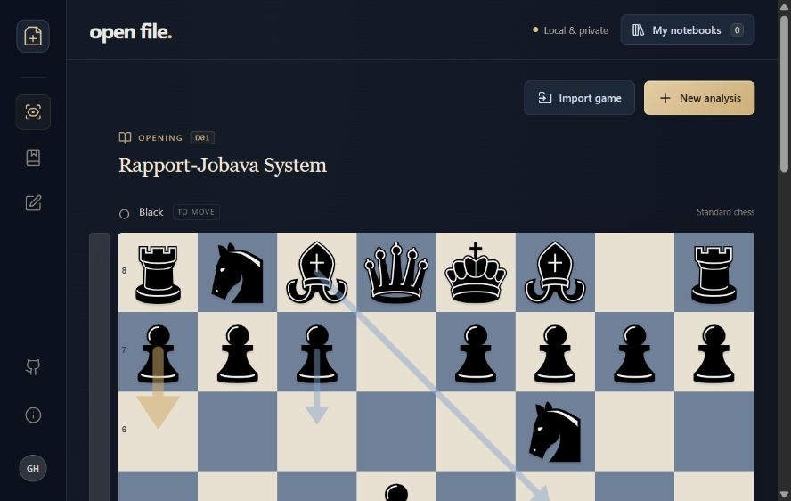
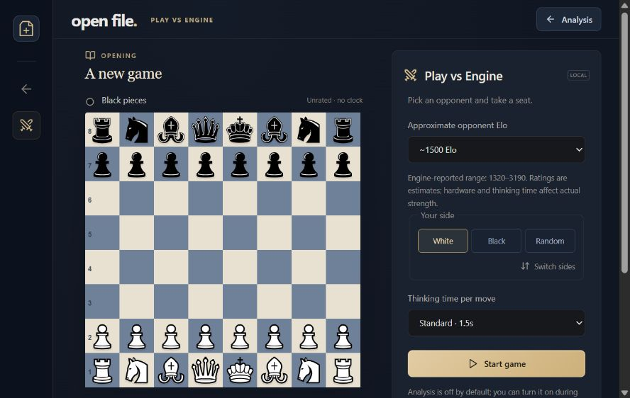

# Open File

**A little room for chess.** A personal chess board with Elo-based engine games, local Stockfish analysis, an opening book, branching variations, and notebooks that stay on your device.

Built with React, TypeScript, Vite, chess.js, Chessground, and Stockfish 19 Lite. No accounts, paid APIs, analytics, or engine servers.



## Run locally

Use **Node.js 22.12+ or 24 LTS** and npm.

```sh
git clone https://github.com/gabeheem/chess-analysis.git
cd chess-analysis
npm ci
npm run dev
```

Open the Local URL printed by Vite (normally `http://127.0.0.1:5173`). If the implementation pull request has not been merged, check out its feature branch first:

```sh
git checkout feat/personal-analysis-app
```

The engine, WASM network, opening index, piece SVGs, and licenses are checked in. You do **not** need an API key, a separate Stockfish installation, or an asset download step. The npm development dependency contains other engine builds, but only the ~1.8 MB Lite single-threaded engine is shipped to the browser.

```sh
npm test          # unit, protocol, and real Stockfish WASM integration tests
npm run build    # TypeScript checks and production build
npm run preview  # serve the production build locally
npm run format   # format application source and documentation
```

## Explore

- The board measures the available window height so its opening heading and all eight ranks fit together without scrolling. Resize the window and it adjusts automatically.
- Drag a piece or click its starting and destination squares. Legal destinations are highlighted. Castling, en passant, and all four promotion choices are supported.
- Stockfish analyzes each position locally, shows up to three candidate lines, and draws best-move arrows. Click a continuation move to add that sequence to your notebook.
- Choose 1, 2.5, 8, or 20 seconds per position, pause analysis, or retry a failed engine. All scores favor White when positive. Mate scores are shown separately.
- Use **← / →**, **Home / End**, or the board controls to navigate; **F** flips the board. Shortcuts are disabled while typing or using a dialog.
- Play another move from an earlier position to create a variation. Existing moves are preserved, and returning to an existing move reuses its branch.
- Import a **PGN**, a six-field **FEN**, or an Open File **JSON** backup. Export the full move tree to PGN, the selected position to FEN, or the complete notebook to JSON.
- Use **Set up a position** to place, erase, and rearrange pieces and choose side to move, castling rights, en passant target, and clocks.
- Save named notebooks with notes. Reopen, rename, download, or delete entries from **My notebooks**. The current workspace also restores automatically after a reload.
- Choose **New analysis → Try a classic** for a Ruy Lopez example with a Berlin alternative.

## Play vs Engine

Choose **Play engine** from the workspace toolbar. Select an approximate Elo, White/Black/random, and 0.5, 1.5, or 3 seconds per engine move. Switch sides before starting. The selector reads `UCI_Elo` limits from the bundled engine at runtime: the shipped Stockfish 19 Lite reports **1320–3190**. `UCI_LimitStrength` and `UCI_Elo` control the opponent; ratings are estimates, not equivalents to a Chess.com, Lichess, or FIDE rating. Hardware and thinking time affect strength.

Only your pieces can move on your turn. Stockfish replies automatically; the interface shows its thinking status, move history, and the last recognized opening. Evaluations, candidate lines, and best-move arrows are off by default. Enable **Show analysis** at any point to reveal full-strength suggestions from a separate local worker; this never changes the opponent's selected Elo. Turning it off removes hints and terminates that analysis worker.

Promotion, castling, and en passant use the same legal move system as analysis. Checkmate, stalemate, insufficient material, fivefold repetition, and the seventy-five-move rule end the game automatically (mate takes priority). Threefold repetition and the fifty-move rule offer an optional claim on your turn, including a claim based on an intended legal move. The engine chooses to claim an available draw on its own turn. Resignation records the result. Restarting returns to setup; leaving an unfinished game asks before discarding it, and pending searches are safely cancelled.

After the result, choose **Analyze this game** to open its complete history in the analysis workspace at full strength (`UCI_LimitStrength=false`, `Skill Level=20`). Export PGN or save/update the game in **My notebooks**, including during play. Returning with **Analysis** preserves the previous analysis workspace; analyzing the completed game replaces it intentionally.

Games have no chess clock. An active game lives in memory and is not resumed after a reload or leaving play: save or export it first. Saved games reopen as analysis notebooks. Each new game starts with hints off.



## Storage, privacy, and offline use

All chess calculation and notebook storage happen in the browser. The app has no backend. Runtime requests go only to its own origin for its JavaScript, WASM, local artwork, and opening index; following an external source link naturally leaves the app.

Notebooks use atomic `localStorage` writes, with visible errors if storage is unavailable or full. Clearing site data, switching browser profiles, or changing the app's origin will change or remove the visible library. **Download JSON backups for important work.** PGN preserves game variations and position comments; JSON additionally preserves notebook notes, title, and selection.

After `npm ci`, the local server and production build run without internet access. This version does **not** include an installable PWA or service worker; a hosted page is not guaranteed to reopen offline after closing it. Keep a local copy for dependable offline access.

## How it works

| Module                              | Responsibility                                                                                                 |
| ----------------------------------- | -------------------------------------------------------------------------------------------------------------- |
| `src/lib/study.ts`                  | Legal moves, immutable move tree, full-history reconstruction, setup validation, and safe notebook restoration |
| `src/lib/pgn.ts`                    | Single-game PGN parser/writer with nested variations and comments                                              |
| `src/engine/controller.ts`          | UCI handshake, search cancellation, matching-depth MultiPV frames, score normalization, and failure timeouts   |
| `src/lib/engineGame.ts`             | Turn enforcement, draw claims, automatic endings, result headers, and stale-move rejection                     |
| `src/engine/usePlayEngine.ts`       | Strength-limited opponent worker lifecycle and game/position request IDs                                       |
| `src/components/PlayVsEngine.tsx`   | Game setup, controls, promotion, saving, and optional isolated live analysis                                   |
| `src/engine/useEngine.ts`           | React worker lifecycle and position-tagged result display                                                      |
| `src/components/Board.tsx`          | Chessground adapter, legal destinations, orientation, and engine arrows                                        |
| `src/components/PositionEditor.tsx` | Free placement and setup fields, separate from normal legal play                                               |
| `src/lib/openings.ts`               | Position lookup and last-recognized opening along the selected branch                                          |
| `src/lib/storage.ts`                | Notebook persistence and portable downloads                                                                    |

**Avoiding stale analysis:** UCI output has no request IDs. When the board changes, the controller clears displayed lines, sends `stop`, ignores output from the old search, and waits for its `bestmove` before starting only the latest requested position. Rendered results are also tagged with the full position command. Candidate ranks are published together at matching depths rather than mixing iterations.

**History matters:** Engine position commands include the root FEN and every move along the selected branch. A FEN alone does not contain repetition history. Imported FENs therefore begin a new history; imported PGNs retain it.

**Opening names:** The index contains 3,865 named positions from the pinned Lichess opening dataset. Position keys retain side to move, castling rights, and legal en passant information while ignoring move counters. The app walks backward along the selected branch to retain the last named opening. It does not provide opening popularity or win-rate statistics.

## Static hosting

Run `npm run build` and serve **all of `dist/`**, including `engine/`, `pieces/`, `data/`, and `licenses/`. The build uses relative paths and can be served at a root or repository subdirectory. Serve the directory's index URL with a trailing slash. There is no client-side URL routing.

- Serve JavaScript as JavaScript and `.wasm` as `application/wasm`.
- Serve over HTTP on localhost or HTTPS when hosted; opening `index.html` as `file://` is unsupported.
- The engine is a classic dedicated worker, single-threaded; `SharedArrayBuffer`, COOP, and COEP headers are not required.
- If adding a Content Security Policy, allow local scripts/workers, `connect-src 'self'`, and WebAssembly compilation (`'wasm-unsafe-eval'` where supported).
- No hosting service is configured or deployed automatically. CI builds a downloadable `dist` artifact without publishing it.

## Validation and limits

Automated checks cover special moves, mate/stalemate, threefold history, branching, nested PGN/comment round-trips, malformed input, illegal setups, corrupted saved data, storage failures, opening transpositions, score orientation, cancellation, matching-depth candidates, and engine timeouts. Real WASM integration tests start the bundled Stockfish engine through the production controller, find mate in one, and verify legal replies at both supported Elo endpoints. Play tests cover turn restrictions, stale/duplicate results, special moves, claimable versus automatic draws, resignation, and returning to full-strength analysis.

Browser smoke checks cover real engine startup and three candidate lines, click-to-move, promotion/underpromotion, invalid FEN feedback, opening recognition, saved notebook reload, and responsive desktop/mobile layout. See [verification notes](docs/VERIFICATION.md) for the exact checks performed during implementation.

Practical limits and deliberate omissions:

- Standard chess only. One PGN game at a time; inputs up to 1 MB, notebooks up to 10,000 positions, imported variation nesting up to 64 levels.
- PGN headers, move variations, and brace/semicolon comments are preserved. Numeric/symbolic annotation glyphs (`$1`, `!?`) are ignored. Comments containing literal braces are sanitized on PGN export. There is no position-comment editor in this version; imported comments appear in move tooltips.
- The setup validator checks static legality, castling pieces, pawn counts, and en passant consistency; it does not prove historical reachability.
- Threefold/fifty-move claims are displayed as claims and pause analysis; you may continue exploring legal moves. Checkmate and stalemate have no continuations.
- Stockfish Lite uses a smaller network and is weaker than full Stockfish. Search results depend on time and hardware. No Syzygy tablebases are included. The evaluation bar is an advantage indicator, **not** a personalized win probability.
- Local storage has a browser-dependent quota and no multi-device sync. Simultaneous editing in multiple tabs is not supported.
- No whole-game review, accuracy scoring, mistake labels, AI coaching, online play, or Chess.com integration.

## Assets and licenses

Original application code is **GPL-3.0-or-later**. Third-party components retain their own licenses. See [LICENSE](LICENSE), [third-party notices](public/licenses/NOTICE.txt), and the [asset manifest](public/data/asset-manifest.json).

In particular: Stockfish.js is GPL-3.0, Chessground is GPL-3.0-or-later, chess.js is BSD-2-Clause, React is MIT, Lucide is ISC with the included Feather notices, Chessnut pieces by Alexis Luengas are Apache-2.0, and opening data is CC0.

The exact [Stockfish.js 19.0.1 release](https://github.com/nmrugg/stockfish.js/releases/tag/v19.0.1), [corresponding source](https://github.com/nmrugg/stockfish.js/tree/v19.0.1), and [source archive](https://github.com/nmrugg/stockfish.js/archive/refs/tags/v19.0.1.tar.gz) are linked in the distributed notices. Engine binaries are unmodified.

`npm run assets` is a **maintainer refresh command**, not a normal installation step. It copies the pinned npm engine, downloads current upstream opening/piece revisions, generates the opening index, and records source revisions and SHA-256 hashes. It requires internet access. Review data/license changes before committing a refresh.
